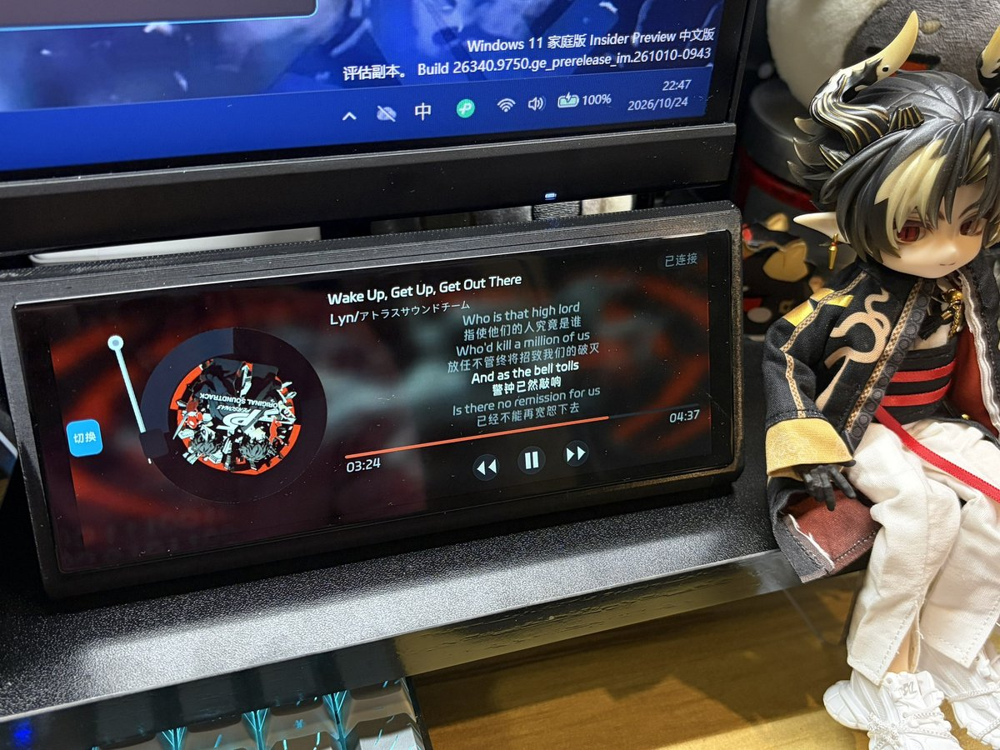

# esp32-p4-music-page



> A NetEase-style vinyl music page for ESP32 touchscreens — mirror and control
> your PC's music player over LAN, with live cover art and scrolling lyrics.
> Windows agent included.

ESP32 触摸屏上的**网易云音乐风格黑胶音乐页**：屏幕实时显示电脑上正在播放的歌
（封面、歌名、滚动双语歌词、进度），并遥控播放/暂停与切歌。板子与电脑同一局域网，
自动发现，板端零配置。

- UI 全部程序化绘制（黑胶盘、唱针、按钮图标都是代码画的），**无图片素材依赖**；
- 电脑端是独立 Python 代理（读网易云窗口标题 + 系统媒体会话 SMTC），板端固件
  只是标准 ESP-IDF + LVGL 组件，可嵌入任何工程；
- 找不到电脑代理时自动进**演示模式**（内置假歌单驱动黑胶旋转与按钮），代理上线无缝接管。

已在 ESP32-P4（AIBox R3 + ESP32-C5 Wi-Fi）+ 6.2 寸 1280×452 MIPI 触摸屏上实机验证。

## 组成

| 目录 | 内容 |
|---|---|
| `components/music_page/` | 板端 ESP-IDF 组件：`music_page.c`（黑胶 UI）+ `music_remote.c`（代理发现/轮询/控制）+ `music_state.c`（状态快照）+ `music_lyric.c`（LRC 解析，纯 C 无依赖） |
| `tools/music_page_agent/` | Windows 电脑端代理 `music_agent.py`（Python，仅 Windows） |
| `tests/` | 宿主回归测试（57 项：LRC 解析、时间格式化、代理选曲/播放时钟/HTTP 接口） |

## 快速开始（板端接入）

前提：ESP-IDF ≥ 5.3、工程里已有 LVGL（~9.x）与 `espressif/esp_new_jpeg`（组件
`idf_component.yml` 已声明，首次构建自动拉取）。目标为 ESP32-P4+C5 的工程需自带
`esp_wifi_remote`（xiaozhi / esp-hosted 类工程已含）。

**1. 把组件放进工程**

```bash
# 方式 A：直接复制
copy components\music_page <你的工程>\components\music_page

# 方式 B：git 子模块
git submodule add https://github.com/exder145/esp32-p4-music-page.git
# 然后在工程 CMakeLists 里：
# set(EXTRA_COMPONENT_DIRS ${EXTRA_COMPONENT_DIRS} esp32-p4-music-page/components)
```

**2. 在自己的页面管理器里接入（三行）**

```c
#include "music_page.h"

// 进入音乐页前注入含 CJK 字形的界面字体（20~25px），否则中日韩歌名缺字
music_page_set_font(your_cjk_font);

// 在独立屏幕对象上构建（首次调用分配 PSRAM 缓冲，此后常驻）
lv_obj_t *screen = lv_obj_create(NULL);
music_page_create(screen);
lv_screen_load(screen);          // 显示

// 离开页面时暂停动画与远控任务，回来恢复
music_page_set_visible(false);   // 离开
music_page_set_visible(true);    // 回来
```

注意：这两个函数**必须在 LVGL 任务上下文**调用（和 LVGL 其他 API 一致）。
布局按 1280×452 横屏设计，其他分辨率改 `music_page.c` 顶部的布局常量。

**3. 电脑端跑代理**

```powershell
cd tools\music_page_agent
pip install -r requirements.txt
python music_agent.py            # 默认端口 8777，防火墙放行
```

板子会在 2 秒内收到 UDP 广播并连上。详见[代理说明](tools/music_page_agent/README.md)。

## 数据链路

```
┌─ Windows 电脑 ────────────────────────────┐
│ 网易云音乐客户端                            │
│   ├─ 窗口标题 ──► 歌名/歌手                 │
│   ├─ SMTC 播放状态（含冻结/无时间线的坑）     │
│   └─ 播放键直点（暂停后恢复不换歌）           │
│ music_agent.py（HTTP 8777 + UDP 广播 9878）│
└──────────────┬───────────────────────────┘
               │ GET /state /art /art_blur /lyrics · POST /cmd
┌──────────────▼───────────────────────────┐
│ music_remote（独立任务）                    │
│  UDP 听广播发现代理 → 1s 轮询状态            │
│  换歌拉封面 JPEG（esp_new_jpeg 解码）/ 模糊图 │
│  整首 LRC → music_lyric 解析（PSRAM 缓冲）   │
│ music_page（LVGL 页面，只读状态快照）        │
└──────────────────────────────────────────┘
```

演示模式：6 秒收不到代理广播即切入，状态胶囊显示"未发现电脑端 · 演示模式"，
界面全部可动（假歌单轮播、黑胶旋转、按钮可点），代理恢复后无缝接管。

## 已知限制（诚实声明）

- **进度条不同步拖动**：网易云不给 SMTC 时间线，位置由代理本地时钟推算
  （切歌归零、暂停冻结、播放累加），板端 250ms 插值。在电脑上拖进度条，屏幕不跟随。
- **暂停后点"播放"**：代理会去真点网易云界面上的播放键（SMTC/媒体键在这时候会让
  网易云随机换歌，这是网易云 3.x 的行为），点不到窗口时退回 SMTC 并可能换歌。
- 曲目靠网易云窗口标题识别：主窗口最小化到托盘也能读，但网易云完全退出则无曲目。
- 韩文谚文无内置字形：注入的字体含韩文即可显示（`music_page_set_font`）。

## 跑测试（无需板子）

```bash
python tests\music_state_test.py    # 5 项：时间格式化/进度/演示模式推进
python tests\music_lyric_test.py    # 13 项：LRC 解析/排序/进度取行/同缓冲解析
python tests\music_agent_test.py    # 39 项：选曲打分/播放时钟/控制指令/HTTP 接口
```

前两个测试用 gcc 现场编译真实 C 源码（Windows 需 mingw gcc 在 PATH）。

## 硬件要求

- ESP32-P4（其他带 Wi-Fi 的 IDF 芯片理论可用，未实测）；
- PSRAM：页面缓冲合计约 1.7MB（模糊背景画布 1.13MB + 黑胶/唱针/封面 + 16KB 歌词）；
- 屏幕：1280×452 横屏（其他分辨率调整布局常量）。

## 许可

[MIT](LICENSE)。`music_agent.py` 调用的网易云公开搜索接口仅用于个人学习，
请遵守网易云服务条款。
